# FlexPrime — Academic Companion for FASTians

> **Built to give every FASTian the prime academic experience they deserve.**
> Marks · Attendance · Timetable · Past Papers · Faculty Hub · Study Plans — faster, smarter, and more useful than the official portal.

---

## Screenshots

  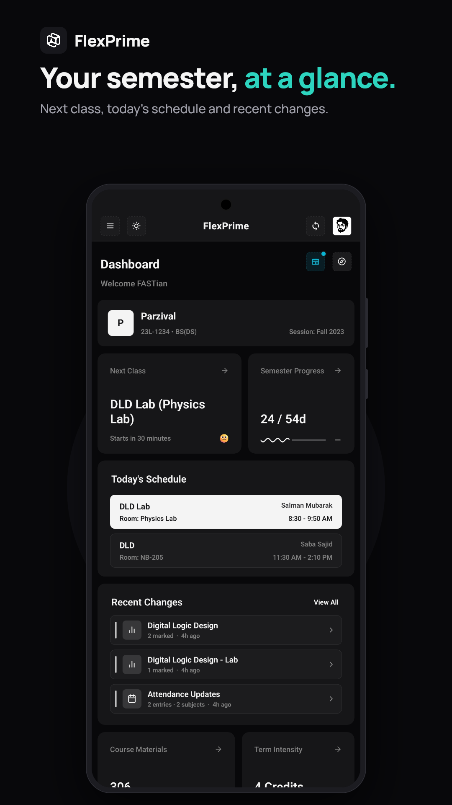
  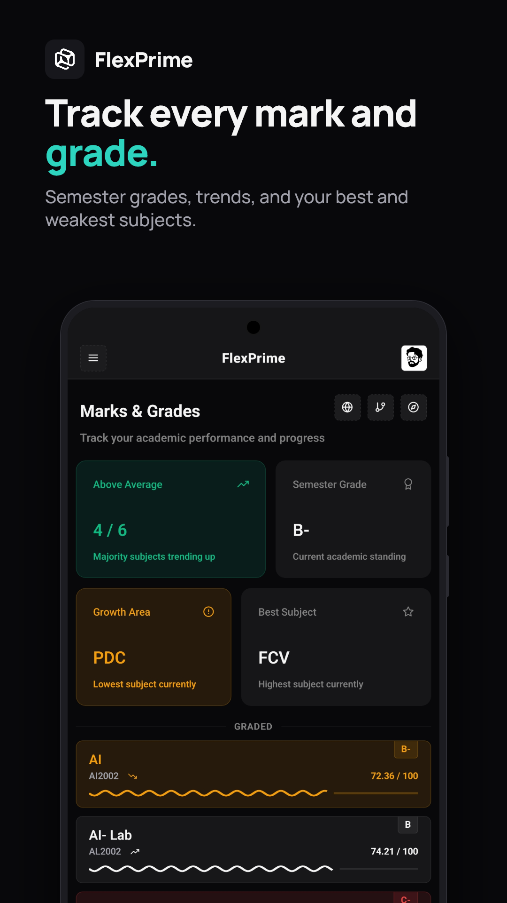
  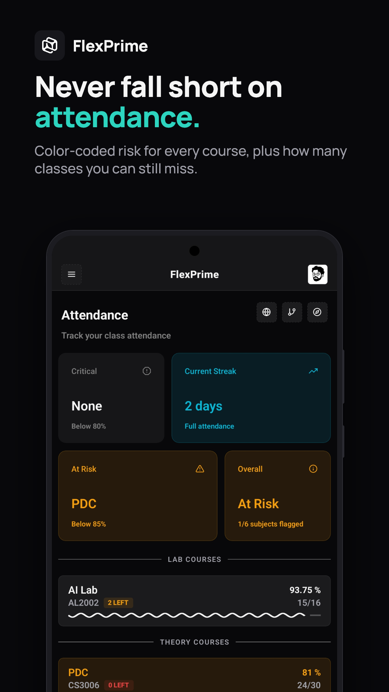
  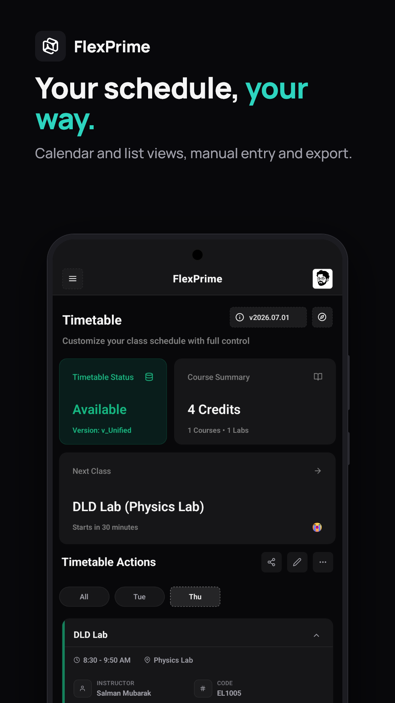
  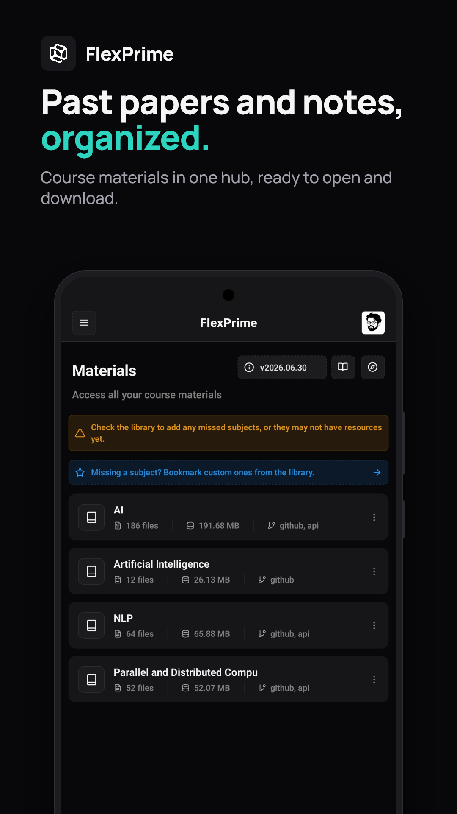

### Core

<table>
<tr>
<td width="170"></td>
<td><b>Dashboard</b> Quick stats, today's schedule and recent changes at a glance, with resource sync.</td>
</tr>
<tr>
<td width="170"></td>
<td><b>Marks &amp; Analytics</b> Weighted averages, predicted grades, SGPA/CGPA and your strongest and weakest subjects.</td>
</tr>
<tr>
<td width="170"></td>
<td><b>Attendance</b> Color-coded risk per course, plus how many classes you can still miss or need to attend.</td>
</tr>
<tr>
<td width="170"></td>
<td><b>Timetable</b> Calendar and list views, manual entry, and export as image or PDF.</td>
</tr>
</table>

<b>Detail screens</b>

 
<table>
<tr>
<td width="170">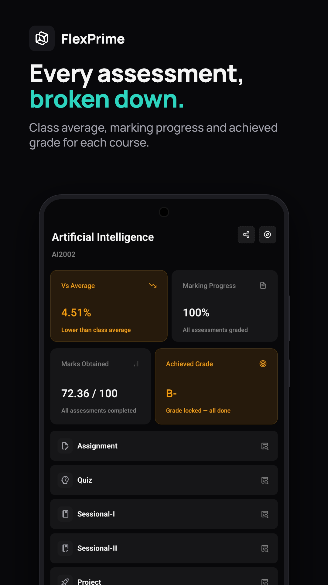</td>
<td><b>Course marks</b> Every assessment with class average comparison and live diff-checking.</td>
</tr>
<tr>
<td width="170">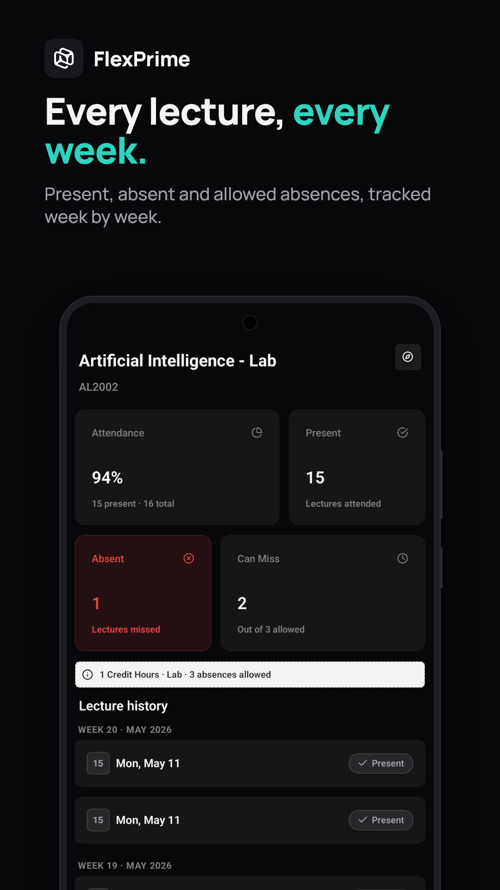</td>
<td><b>Course attendance</b> Week-by-week lectures: present, absent and allowed absences.</td>
</tr>
</table>

<b>Resources &amp; community</b>

 
<table>
<tr>
<td width="170"></td>
<td><b>Materials Hub</b> Past papers, notes and outlines organized by course.</td>
</tr>
<tr>
<td width="170">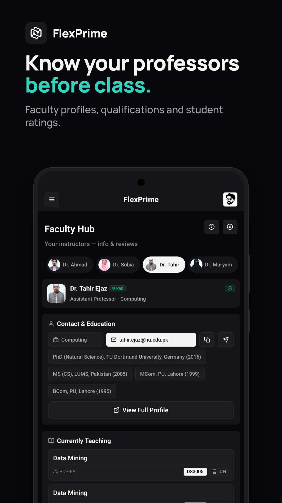</td>
<td><b>Faculty Hub</b> Professor profiles and student ratings.</td>
</tr>
<tr>
<td width="170">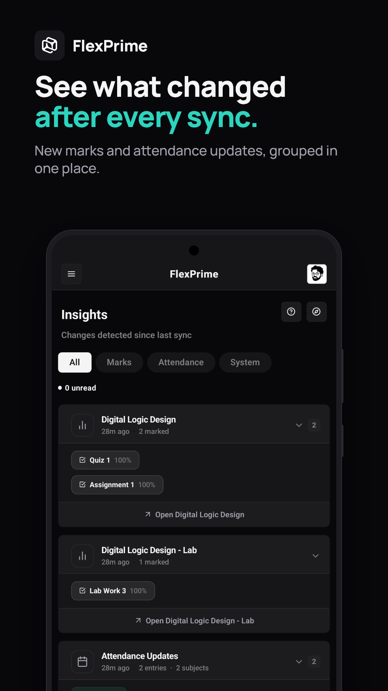</td>
<td><b>Insights</b> Recent changes after every sync, grouped by marks and attendance.</td>
</tr>
</table>

<b>Help &amp; navigation</b>

 
<table>
<tr>
<td width="170">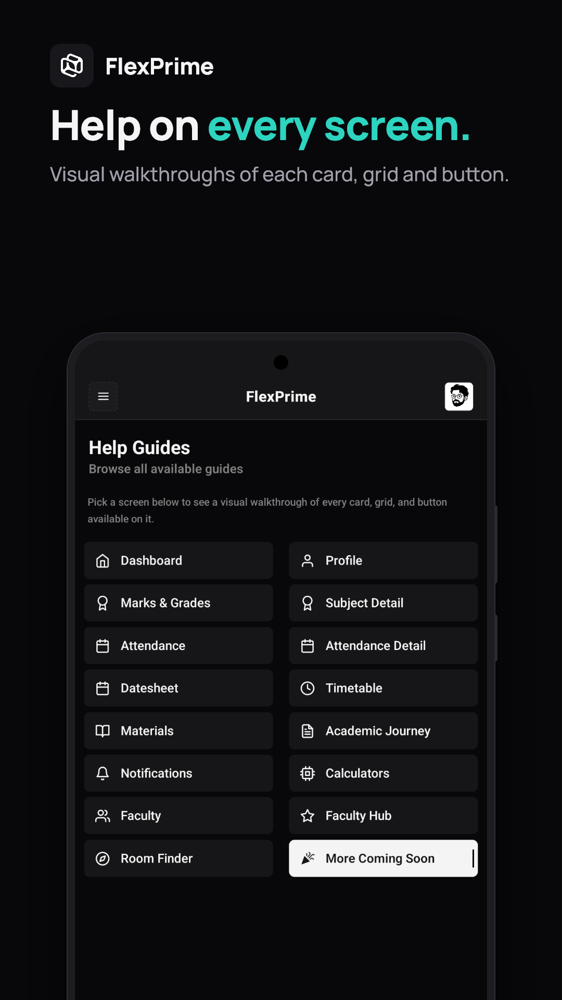</td>
<td><b>Help Guides</b> Visual walkthroughs of each card, grid and button.</td>
</tr>
<tr>
<td width="170">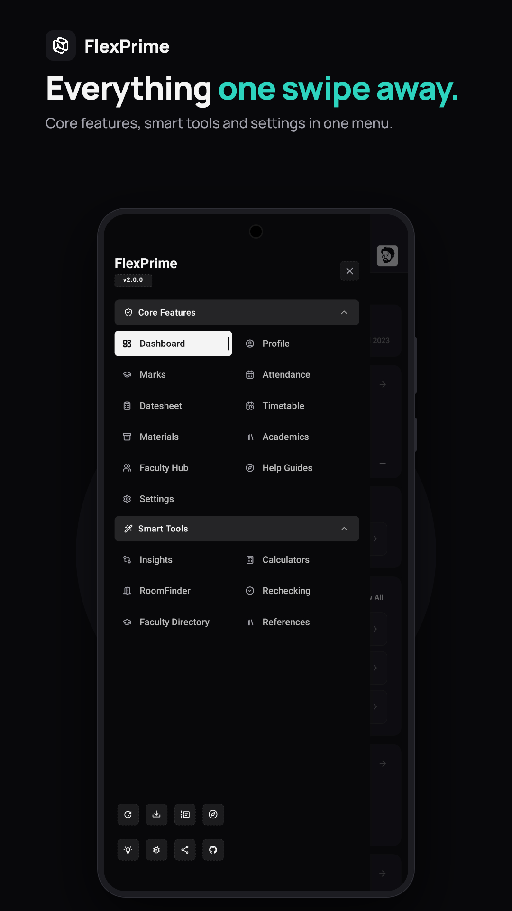</td>
<td><b>Menu</b> Core features, productivity tools and customization (dark mode, AMOLED, accent colors).</td>
</tr>
<tr>
<td width="170">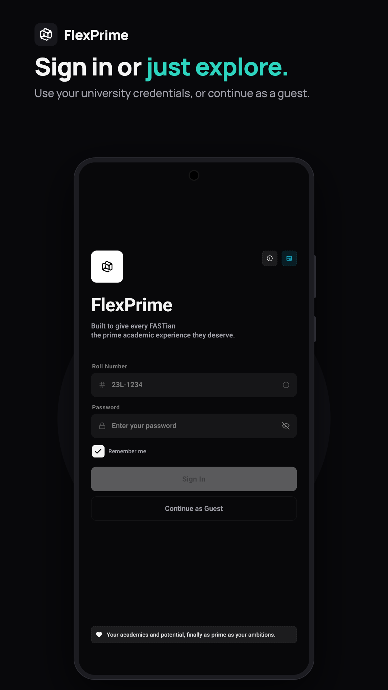</td>
<td><b>Login</b> Sign in with university credentials or continue as a guest.</td>
</tr>
</table>

---

## Why FlexPrime?

The official Flex portal works — but barely. No analytics, no insights, no way to track your progress meaningfully. FlexPrime was built out of frustration with that experience and a belief that students deserve better tools.

Everything the portal does, FlexPrime does faster. Everything it doesn't do — analytics, insights, materials hub, faculty reviews, productivity tools — FlexPrime does that too.

---

## Features

### Dashboard
- Centralised overview of your academic life at a glance
- Quick stats: attendance, GPA, upcoming classes, pending assignments
- **Recent Changes**: see what's new after every sync — marks updates, attendance changes, and system detections, each tappable to navigate directly
- Resource Sync status indicator with on-demand refresh

### Marks & Analytics
- Semester-wise marks breakdown with weighted averages and predicted grades
- Live diff-checking — notified the moment new marks are posted
- Class average comparisons and performance tracking
- Approximated SGPA/CGPA the official portal doesn't provide
- Absolute grading scheme support
- Repeat/improvement detection from transcript history

### Attendance
- Real-time percentages with color-coded risk indicators
- "Classes to Bunk" and "Classes Needed" calculators per subject
- Subject-wise present/absent/leave breakdown
- Weekly attendance summaries on the dashboard

### Timetable
- Clean calendar and list views with venue and instructor details
- **Manual Timetable Entry** — build your schedule manually when the server can't provide it
- Export as image or PDF
- Ramadan-adjusted schedule support

### Datesheet & Exams
- Full exam schedule with date, time and venue
- Clash detection and countdown timers
- Export as image or PDF for offline reference

### Materials Hub
- Past papers, outlines, notes and more — aggregated from multiple trusted sources
- Smart categorisation by course, type and semester
- Bookmarking, search and direct download
- URL fragment handling fixes for reliable paper access

### Faculty Hub
- Professor profiles, qualifications and contact info (Lahore campus)
- **Ratings and feedback** from previous students, powered by NucesRate
- Fuse.js-powered search across live faculty data

### Study Plan & Transcript
- Semester-wise course progression with credit hour tracking
- Degree completion progress and prerequisite chains
- Full academic history beautifully presented

### Help Guides
- Nearly every screen comes with its own contextual help guide
- Tap the info icon to see what each card, grid, and button does
- First-time tour on opening Help Guides for the first time

### Notifications
- Smart class notifications with semester-boundary awareness
- Re-engagement reminders during breaks
- Automatic sanity checks and self-healing on startup
- Background sync and notification rescheduling

### Productivity
- **Applications Generator** — structured leave/extension applications
- **Assignments Tracker** — deadline management and task types
- **GPA Calculators** — SGPA and CGPA planning with what-if scenarios (overhauled)
- **Room Finder** — find available rooms and labs across campus
- **Notes** — rich text editor with markdown support
- **Rechecking Schedule** — apply for and track paper rechecking

### Guest Mode
- Browse and explore the app without signing in
- Useful for previewing features before committing your credentials

### Customization
- Dark mode with custom accent colors
- AMOLED pure-black background option
- Font scaling, border radius and spacing controls
- Concise UI mode for information-dense layouts

---

## Installation

1. Download the latest APK from the [Releases Page](https://github.com/FarhanZafarr-9/FlexPrime/releases/latest)
2. Enable **Install from Unknown Sources** if prompted
3. Install and launch — sign in with your university credentials
4. Your data syncs automatically on first login

### Or install with Obtainium

[Obtainium](https://github.com/ImranR98/Obtainium) installs and updates apps straight from their release pages. Add FlexPrime once and every new version lands on your device automatically — no manual downloads, no hunting through release notes.

1. Grab Obtainium from [its latest release](https://github.com/ImranR98/Obtainium/releases/latest)
2. Tap the badge above — or open Obtainium, tap **Add App**, and paste `https://github.com/FarhanZafarr-9/FlexPrime`
3. Tap **Install**. That's it — updates are pulled from GitHub Releases from then on

Badge taps only work on Android with Obtainium installed. Everyone else: use the steps above.

---

## Known Limitations

- App may crash on first launch due to initial setup/update checks — relaunching 2–3 times usually resolves it
- App is currently built for FAST-NUCES Lahore campus only

---

## Tech Stack

React Native · Expo SDK 53 · Supabase · React Navigation 7 · Reanimated · FlashList · Day.js · React Native Paper · Material You Colors

---

## Data Sources

- Materials: [Academic Time Machine](https://github.com/saleha-muzammil/Academic-Time-Machine), [CampusPlus](https://www.campusplus.live/past-papers)
- Reviews: [NucesRate](https://nucesrate.vercel.app/)
- All data fetched ethically within respective site policies

---

## Disclaimer

FlexPrime is an independent student project and is **not officially affiliated with, endorsed by, or connected to FAST-NUCES** or its official Flex Student Portal. All data is sourced from official university portals and public resources. Always verify critical information through official university channels.

---

## Contact & Support

- Email: flexprime.dev@gmail.com
- Bug reports: [GitHub Issues](https://github.com/FarhanZafarr-9/FlexPrime/issues)
- In-app feedback available from the app menu

---

## About

Made with ❤️ by Parzival — a solo passion project built late nights between classes and exams, started August 2025. If FlexPrime helped you, share it with a classmate.

